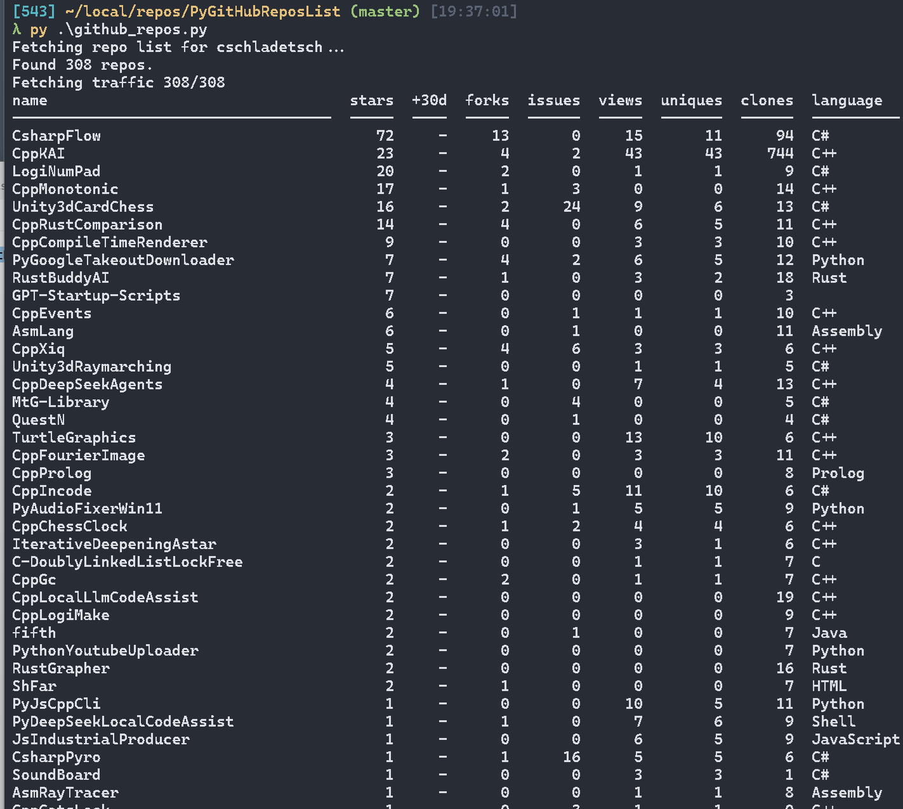

# github_repos

A small Python script that lists all of a GitHub user's repositories, sorted by stars, views, clones and other metrics, and keeps a local history so the numbers mean more than GitHub's 14-day window.



## Features

- Lists every repo owned by a user (including private repos when authenticated as that user)
- Shows stars, star growth, forks, open issues, views, unique views, clones, language, last push date, and fork/private/archived flags
- Keeps a SQLite history, so star growth builds up over repeated runs (cumulative views and clones are in the JSON and CSV output)
- Shows progress while fetching, and Ctrl-C exits promptly
- Distinguishes "no data" from zero: repos whose traffic you cannot read show `-`
- Retries with backoff on rate limits and server errors
- Per-repo star history by month, and referrer and popular path reports
- Table, CSV or JSON output

## Requirements

- Python 3.9+
- [`requests`](https://pypi.org/project/requests/)

```
pip install -r requirements.txt
```

## Authentication

Stars, forks and issues are public and need no token. Views and clones come from GitHub's traffic API, which requires push access to the repo. The token is taken from the first of these that is set:

1. `GITHUB_TOKEN`
2. `GH_TOKEN`
3. `gh auth token` (the GitHub CLI, if installed and logged in)

A classic token needs the `repo` scope. A fine-grained token needs read access to repository administration.

## Usage

```
python github_repos.py                          # sorted by stars, then views
python github_repos.py --sort stars_delta       # fastest growing (needs history)
python github_repos.py --no-forks --top 50      # top 50 non-fork repos
python github_repos.py --no-traffic --no-db     # public data only, no token needed
python github_repos.py --csv repos.csv          # also write a CSV
python github_repos.py --json > repos.json      # JSON instead of a table
python github_repos.py --star-history CppKAI    # stars per month for one repo
python github_repos.py --sources CppKAI         # referrers and popular paths for one repo
```

## Options

| Option                  | Description                                                                 |
| ----------------------- | --------------------------------------------------------------------------- |
| `--user`                | GitHub username (default: `cschladetsch`)                                   |
| `--sort`                | `stars`, `stars_delta`, `views`, `uniques`, `clones`, `forks`, `issues`, `updated`, `name` |
| `--days N`              | Window for the star growth column (default: 30)                             |
| `--db PATH`             | History database (default: `~/.github_repos.db`)                            |
| `--no-db`               | Do not read or write history                                                |
| `--no-traffic`          | Skip views and clones                                                       |
| `--no-forks`            | Exclude forked repos                                                        |
| `--no-archived`         | Exclude archived repos                                                      |
| `--top N`               | Show only the first N rows                                                  |
| `--csv FILE`            | Also write results to a CSV file                                            |
| `--json`                | Print JSON instead of a table                                               |
| `--star-history REPO`   | Print new and total stars per month for one repo                            |
| `--sources REPO`        | Print referrers and popular paths for one repo (last 14 days)               |

Ties are broken by stars, then views, then name, so the ordering is stable. Rows with no data for the sort column come last.

## History

GitHub keeps only 14 days of traffic. Each run merges that window into the SQLite database, so:

- `views_all` and `clones_all` in the JSON and CSV output are cumulative totals since the first run
- the `+30d` column shows stars gained since the newest snapshot that is at least 30 days old, and shows `-` until such a snapshot exists

Run the script on a schedule (cron, Task Scheduler) at least once every two weeks to avoid gaps in traffic history. Running it daily also gives the star growth column finer data.

## Output

A plain-text table followed by a totals line:

```
name        stars  +30d  forks  issues  views  uniques  clones  language  updated     flags
----------  -----  ----  -----  ------  -----  -------  ------  --------  ----------  -----
...

282 repos, 1234 stars, 5678 views (last 14 days)
```

Flags: `F` fork, `P` private, `A` archived.

## Tests

```
python -m unittest discover -s tests -v
```

## License

MIT
